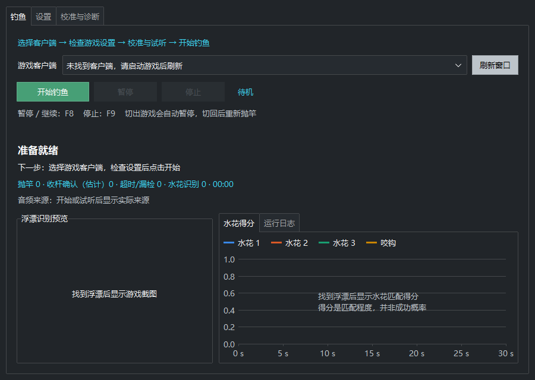
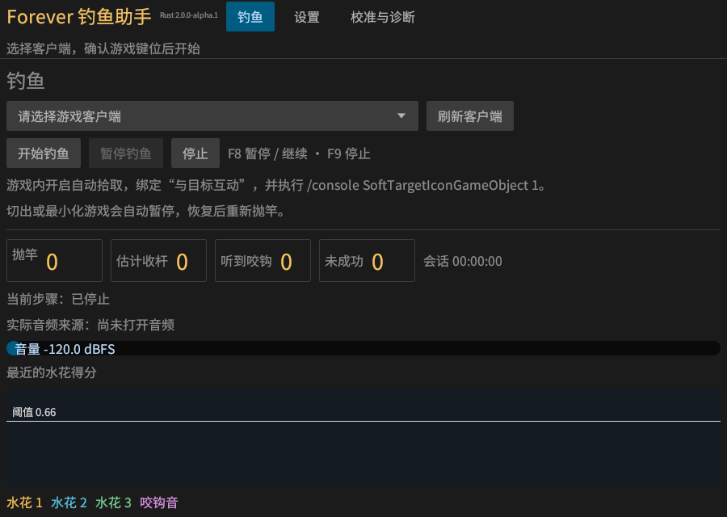

# Forever 钓鱼助手（中文）

[](https://github.com/hellomrli/forever-fishing-zh/actions/workflows/ci.yml)
[](https://github.com/hellomrli/forever-fishing-zh/releases/latest)

面向 **World of Warcraft: Forever** 的中文桌面钓鱼工具。参考 [rsamf/wow-fishing-forever](https://github.com/rsamf/wow-fishing-forever)，修复窗口定位、截图同步、收杆计数、配置保存和音频线程等问题，增加自己的浮漂画面确认、全局快捷键和手动识别范围。

通过屏幕图像、声音和模拟按键工作；无需 GPU。Windows 发布包包含 Python 运行环境，下载后直接运行。

当前 `rust-rewrite` 分支还提供 **Rust 原生预览版 2.0.0-alpha.1**，使用 egui 中文界面和原生 Windows 截图、按键及 WASAPI 音频接口。可执行程序内置中文字体、图标和音频素材，运行时无需 Python。构建与使用方法见 [Rust 使用说明](docs/Rust使用说明.md)；下方正式版下载链接仍对应 Python v1.0.1。

## 下载与使用

- **[下载 Windows 中文界面 EXE](https://github.com/hellomrli/forever-fishing-zh/releases/latest/download/ForeverFishing.exe)**
- [完整发布页](https://github.com/hellomrli/forever-fishing-zh/releases/latest)：GUI、可选命令行版、便携 ZIP、SHA256 校验值。
- [Windows 使用说明](docs/Windows使用说明.md)

支持 Windows 10 / 11 **64 位**。游戏进程音频在启动或试听时实际检测；不支持时，默认回退到系统回环，并显示真实声音来源。进程回环 API 要求 Windows Build 20348+；常见 Windows 10 客户端可使用系统回环。

1. 下载并打开 `ForeverFishing.exe`，在“钓鱼”页选择游戏客户端。
2. 游戏内绑定抛竿键和“与目标互动”键，开启自动拾取，站到水边。
3. 执行 `/console SoftTargetIconGameObject 1`，让浮漂显示金色齿轮。
4. 在“设置”页保存对应按键；在“校准与诊断”页试听并确认声音来源。
5. 点击“开始钓鱼”后切回游戏。默认 **F8 暂停 / 继续，F9 停止**；切出游戏也会自动暂停。

工具依赖客户端提供交互图标、对应互动键和自动拾取功能。第一次抛竿会自动测量图标；识别不稳定时，可手动校准或框选自己的水面区域。收杆确认是图标连续消失后的**估计计数**，不代表已核实鱼进入背包。

v1.0.1 进一步完善了暂停、音频任务切换和录音分析：补饵被打断后会在恢复时重新使用；切换试听、录音或开始钓鱼时等待旧设备释放并自动继续，等待期间仍可停止；录音分析分批执行，支持取消。详见 [v1.0.1 完善记录](docs/修复与验证.md#v101-完善)。

## 中文界面

下图来自 Windows 原生构建 EXE 的界面自检。



| 页面 | 功能 |
| --- | --- |
| 钓鱼 | 多客户端选择、开始 / 暂停 / 停止、当前步骤、计数、实际音频来源、浮漂预览、水花得分和日志 |
| 设置 | 游戏按键、补饵周期、时限、可选退出宏、全局快捷键、画面确认阈值 |
| 校准与诊断 | 命令和宏复制、设备刷新、试听、录音验证、阈值建议、图标校准、水面框选、任务取消、环境诊断、日志导出 |

设置和诊断页支持滚动，在 900×640 最小窗口下仍可访问底部按钮。按钮、状态、说明和常见错误采用中文；设备名称保留系统提供的名称。

## 修复和验证

- [上游项目评审](docs/上游项目评审.md)：改版前的问题与证据。
- [修复与验证记录](docs/修复与验证.md)：R01–R10 的对应改动、回归覆盖和验证边界。
- CI 在 Linux 与 Windows 运行离线回归测试，并打开真实 Tk 界面测试 100%、125%、150% 字体缩放。
- Windows 构建后会运行**生成的 EXE**，检查中文页面、配置、图片路径、全局快捷键、原生窗口移动 / 缩放 / 最小化恢复及截图。

自动化验证不包含真实 Forever 客户端中的钓鱼联调；不同客户端、UI 皮肤和水面效果可能需要调整校准和阈值。

## 从源码运行

需要 Python 3.12+ 和 [uv](https://docs.astral.sh/uv/)。

```bash
uv sync --locked --group dev
uv run foreverfish gui
uv run pytest
uv run ruff check .
uv run ruff format --check .
```

Windows 原生打包：

```powershell
uv run pyinstaller --clean --noconfirm packaging/wowfish.spec
uv run python -m wowfish.gui.launcher --smoke-test checks/gui.json
```

输出为 `dist/ForeverFishing.exe` 和 `dist/ForeverFishing-CLI.exe`。EXE 必须在 Windows 上构建；Linux 开发环境的自检可用 `xvfb-run -a` 提供虚拟显示。

配置使用 UTF-8 TOML，存放在系统用户配置目录的 `ForeverFishing` 文件夹中。“设置”页显示完整路径；也可执行 `foreverfish config --path`。设置环境变量 `FOREVERFISH_HOME` 可统一指定配置、缓存与日志目录；兼容旧的 `WOWFISH_HOME`。

命令行还支持 `run`、`listen`、`watch`、`calibrate`、`verify-bite` 和 `doctor`，运行 `foreverfish --help` 查看中文帮助。

## Rust 原生预览版

Windows 预览包：[下载 GUI EXE](https://github.com/hellomrli/forever-fishing-zh/releases/download/rust-v2.0.0-alpha.1/ForeverFishing-Rust.exe) · [下载便携 ZIP](https://github.com/hellomrli/forever-fishing-zh/releases/download/rust-v2.0.0-alpha.1/ForeverFishing-Rust-v2.0.0-alpha.1-Windows-x64.zip) · [Rust 发布页](https://github.com/hellomrli/forever-fishing-zh/releases/tag/rust-v2.0.0-alpha.1)。发布文件由 Windows 原生构建、自检通过后生成。

需要 Rust 1.88+。Windows 10 / 11 64 位支持游戏窗口、截图、按键、全局快捷键及音频捕获；Linux 支持开发、中文界面和离线图像 / WAV 分析。

```bash
cargo build --workspace --release --locked
cargo run --locked --bin ForeverFishing-Rust
cargo test --workspace --locked
cargo fmt --all -- --check
cargo clippy --workspace --all-targets --locked -- -D warnings
```

Windows 生成 `target/release/ForeverFishing-Rust.exe` 和 `ForeverFishing-Rust-CLI.exe`。执行 `./scripts/rust/package.ps1` 可生成便携 ZIP、许可证、构建信息和 SHA256 校验文件。Rust 版沿用现有 UTF-8 TOML 配置；也可用 `FOREVERFISH_HOME` 为预览版指定单独的数据目录。

下图来自 Linux 上运行 Rust release 程序的真实界面自检，使用内置 Regular 中文字体：



[Rust Native 工作流](.github/workflows/rust.yml)在 Linux / Windows 运行回归和数值对照测试，Windows 原生构建后执行生成 EXE 的界面自检，再生成预览包。自检覆盖 900×640 窗口、100% / 125% / 150% 字体缩放、设置与诊断页底部按钮。详见 [Rust 完善与验证记录](docs/Rust修复与验证.md)和 [2.0.0-alpha.1 发布说明](docs/releases/rust-v2.0.0-alpha.1.md)。

## 来源与许可

源代码采用 MIT 许可证，保留原作者 Richard Franklin 的版权声明。参考基线是上游提交 `7e37aca73e018077087fe8bf34c05fd012babda4`。本项目独立维护，详见 [第三方说明](THIRD_PARTY_NOTICES.md) 和 [贡献指南](CONTRIBUTING.md)。
