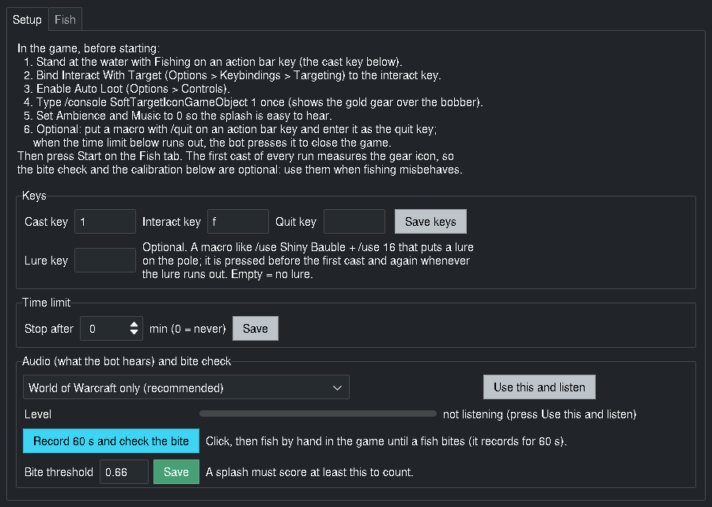

# Forever 中文钓鱼工具：上游项目评审

> 这是改版前的评审记录。下文的上游测试和错误复现结果属于参考基线；当前修复和验证见 [修复与验证记录](修复与验证.md)。

建议以 [rsamf/wow-fishing-forever](https://github.com/rsamf/wow-fishing-forever) 的当前实现为基础开发中文桌面版。它已经针对 World of Warcraft: Forever 重写，图像、音频、键盘输入、状态机和界面有明确的模块边界，适合继续完善。中文首版需要同时处理客户端定位、运行稳定性、配置保存和操作流程。

本次评审日期为 2026-11-17，源码固定在 `main` 的提交 `7e37aca73e018077087fe8bf34c05fd012babda4`，而非历史上的 2019 年旧实现。读取到的最新正式发布为 [v1.2.0，2026-11-12](https://github.com/rsamf/wow-fishing-forever/releases/tag/v1.2.0)。自动补鱼饵在该版本发布之后合入 `main`，评审源码与现成发布包的功能和修复情况应分别核对。

验证环境为 Linux、CPython 3.12.16、上游锁定的依赖、合成输入以及 Xvfb 虚拟显示。下文明确区分离线复现、界面实测、源码分析和待实机验证的事项。Forever 客户端联调和 Windows 实机打包验证属于后续开发的验收内容。

## 可以复用的部分

| 上游已有能力 | 现有实现与复用价值 |
| --- | --- |
| 桌面界面 | Python、ttkbootstrap，已有设置和钓鱼页面；Presenter 不依赖 Tk，便于验证业务逻辑。 |
| 钓鱼流程 | 已有抛竿、寻找图标、等待水花、交互、暂停和停止状态；外部依赖可注入。 |
| 图像识别 | OpenCV 模板匹配、金色过滤、局部跟踪、自动测量图标大小；亮水面阴影处理已改进。 |
| 音频识别 | 四种内置水花音频的 log-mel 指纹匹配；已有咬钩得分曲线、录音验证与阈值建议。 |
| 音频来源 | Windows WASAPI、Linux PipeWire 的游戏进程音频，以及系统回环设备；同一游戏进程里的其他声音仍会进入识别器。 |
| 使用辅助 | 配置校验、环境诊断、超时重抛、时限、可选退出宏、自动补鱼饵。 |
| 开发和发布 | MIT 许可证、锁定依赖、单元测试、三个系统的 CI、PyInstaller 打包以及 GUI 启动检查。 |

这套方案通过屏幕像素、声音和模拟按键完成操作，不需要 GPU，也没有读取游戏内存的实现。能否用于目标 Forever 客户端，关键在于该客户端是否提供交互图标、对应交互键和自动拾取功能，需要在实际客户端上确认。

## 已确认的问题及修改优先级

这里的 P0 表示中文首版的前置修改，P1 表示首版稳定性需要完成的修改；它们是本项目的开发优先级。

| 编号 | 优先级 | 问题 | 用户影响 | 证据 |
| --- | --- | --- | --- | --- |
| R01 | P0 | 游戏窗口名在多处固定为 `World of Warcraft` | 中文“魔兽世界”客户端找不到；只改一处或只传 CLI 的 `--title` 仍有遗漏。 | 离线复现；另有上游 Issue #20。 |
| R02 | P1 | 引擎更新窗口信息，截图器仍持有旧的窗口位置和尺寸 | 拖动、缩放窗口后识别区域不正确，可能反复超时。 | 使用真实 `MssCapturer` 逻辑、替换底层截图接口复现移动和缩放两种情况。 |
| R03 | P1 | 交互后一次图标识别失败就记作成功 | 瞬时识别波动也会增加成功计数，且没有确认物品入包。 | 离线复现：一次漏检后计数为 1，下一帧图标仍存在。 |
| R04 | P1 | 保存音频设备使用过期的整份配置 | 可以覆盖后台刚保存的图标校准结果；手动保存校准也有相同的覆盖机制。 | 音频设置路径复现：校准大小从 53 被覆盖成 0。 |
| R05 | P0 | 配置读写使用默认编码，而配置升级明确使用 UTF-8 | 中文 Windows 的默认编码可能造成中文设备名、配置注释解码失败。 | 模拟 CP936 默认写入后，升级配置发生 `UnicodeDecodeError`。 |
| R06 | P1 | 抛竿键和交互键没有在配置加载时校验 | 错误键位、空交互键可以加载，到运行时才失败。 | 离线复现：`not-a-key` 和空交互键均被接受。 |
| R07 | P1 | 游戏有焦点时，主循环缺少等待或频率限制 | 即使没有新音频、未到截图时间，仍持续空转。 | 合成环境约 20 万次循环/秒，休眠次数为 0。 |
| R08 | P1 | Windows 音频超时只累加额外休眠，没有计算底层等待 | 配置的 5 秒无音频超时，在无包且事件未触发时可变成约 105 秒，影响资源释放和重新开始。 | 注入模拟时钟和无音频包后端，复现 105.205 秒。 |
| R09 | P1 | 试听线程的打开设备异常没有传回界面 | 试听停止，界面却没有显示设备打开失败的原因。 | 注入打开失败的音频源，线程异常存在，GUI 错误消息为空。 |
| R10 | P1 | 设置页在允许的最小窗口尺寸下放不下全部控件 | 底部图标校准区被挤掉；中文说明和较大字体会进一步影响布局。 | Linux 虚拟显示下将窗口设为 900×640，校准区实际高度只有 1 像素。 |

**R01：统一客户端选择和参数传递。**

[Presenter](https://github.com/rsamf/wow-fishing-forever/blob/7e37aca73e018077087fe8bf34c05fd012babda4/src/wowfish/gui/presenter.py#L25) 在前置检查、校准和游戏音频查找中使用英文窗口名；[引擎重抛和退出检查](https://github.com/rsamf/wow-fishing-forever/blob/7e37aca73e018077087fe8bf34c05fd012babda4/src/wowfish/engine/engine.py#L194) 也重新传入固定的英文名。`build_engine(title=...)` 虽然支持自定义标题，但传给引擎的查找函数会被后续显式传入的英文名覆盖，因此 CLI 的自定义标题没有完整贯穿运行过程。

复现中，“魔兽世界”窗口确实存在，GUI 音频查找得到的 PID 却为 `None`；退出检查也会误认为窗口已经关闭。上游 [Issue #20](https://github.com/rsamf/wow-fishing-forever/issues/20) 已报告中文窗口名问题。

建议增加“选择游戏客户端”，自动发现中文和英文标题，并允许手动选择窗口；运行时绑定选定的窗口句柄和 PID。截图、音频、焦点检查、校准、重抛和退出都使用同一个客户端引用。上游按标题子串选择面积最大的窗口，还应补充多客户端和同名窗口的选择测试。

**R02：同步截图器的窗口信息。**

[引擎 `_cast()`](https://github.com/rsamf/wow-fishing-forever/blob/7e37aca73e018077087fe8bf34c05fd012babda4/src/wowfish/engine/engine.py#L198) 重新找到窗口后，只更新 `self.window`。[`MssCapturer`](https://github.com/rsamf/wow-fishing-forever/blob/7e37aca73e018077087fe8bf34c05fd012babda4/src/wowfish/capture/_mss.py#L30) 则继续使用 `open()` 时保存的旧窗口对象。

复现将窗口从 `(10, 20)` 移至 `(110, 120)`，截图仍取 `(10, 20)`；将客户区从 `80×60` 改为 `100×90`，截图仍取 `80×60`。建议为截图器提供窗口更新方法，定期检查位置、尺寸和 DPI；发生变化时更新捕获区域并重新获取浮漂。窗口句柄或 PID 变化时，也要重新建立对应资源。

**R03：增加收杆确认，准确命名统计。**

[`_after_interact()`](https://github.com/rsamf/wow-fishing-forever/blob/7e37aca73e018077087fe8bf34c05fd012babda4/src/wowfish/engine/engine.py#L319) 看到 `_track()` 返回一次 `False` 就增加 `catches`。等待咬钩阶段的连续漏检机制没有用于这个成功判定。

建议用连续多帧和持续时间确认图标消失，并在拾取超时前继续检查。中文界面应区分抛竿次数、咬钩识别次数、成功收杆估计和超时次数；目前的信号不足以把“收杆成功”直接写成“实际钓到的鱼数”。如需统计实际入包或背包满，需要增加可验证的拾取信号。

**R04—R06：统一配置更新。**

[保存音频设备和手动校准](https://github.com/rsamf/wow-fishing-forever/blob/7e37aca73e018077087fe8bf34c05fd012babda4/src/wowfish/gui/presenter.py#L245) 使用 Presenter 缓存的配置，可能覆盖引擎刚写入的设置。[`save_config()`](https://github.com/rsamf/wow-fishing-forever/blob/7e37aca73e018077087fe8bf34c05fd012babda4/src/wowfish/config.py#L221) 直接重写整个文件；普通保存缺少统一的锁和原子替换，也会丢掉原有注释及未识别字段。

建议建立统一的配置更新入口，在锁内读取当前配置，只更新目标字段，再通过临时文件原子替换。已有 tomlkit 可以保留中文注释和用户配置。所有文本读写明确使用 UTF-8，损坏配置通过中文错误提示和备份恢复处理。抛竿键、交互键应与鱼饵键、退出键使用一致的加载校验，界面保存和 CLI 加载采用同一套规则。

**R07—R09：完善等待、超时和错误传递。**

[引擎主循环](https://github.com/rsamf/wow-fishing-forever/blob/7e37aca73e018077087fe8bf34c05fd012babda4/src/wowfish/engine/engine.py#L162) 在有焦点时没有统一等待，而 `ThreadedSource.read()` 本身是立即返回的。离线实验在没有新音频时仍持续空转。实验中的 CPU 数值来自合成环境，用于证明这条路径缺少等待；真实游戏的整体负载需要另行测量。建议使用可被停止事件唤醒的等待，限制状态检查和截图频率，同时保持音频持续采集。

[`ProcessLoopbackSource.read()`](https://github.com/rsamf/wow-fishing-forever/blob/7e37aca73e018077087fe8bf34c05fd012babda4/src/wowfish/audio/_wasapi.py#L182) 的超时累加只计算 5 毫秒额外休眠；[`read_packet()`](https://github.com/rsamf/wow-fishing-forever/blob/7e37aca73e018077087fe8bf34c05fd012babda4/src/wowfish/audio/_wasapi.py#L347) 内部却可能等待 100 毫秒。建议以单调时钟的截止时间计算超时，让底层等待可取消。

[`_Meter._run()`](https://github.com/rsamf/wow-fishing-forever/blob/7e37aca73e018077087fe8bf34c05fd012babda4/src/wowfish/gui/presenter.py#L145) 没有把打开和读取设备的异常交回结果队列。应统一处理后台错误，在界面保留具体原因。校准和录音验证线程也应具有取消机制，并由统一的任务管理入口负责停止和释放。

**R10：调整页面布局。**

上游窗口允许最小尺寸 `900×640`，实测设置页所需尺寸为 `914×704`，实际可用尺寸为 `880×590`，底部校准区无法正常显示。截图为本次运行生成：



建议拆分常用设置和校准诊断，增加滚动容器，让说明随窗口宽度换行。中文字体、系统缩放、首次校准后显示的截图都应加入布局验收。

## 还需要完善和实机核对的部分

**识别自己浮漂的咬钩。**

当前水花声音过阈值即可触发交互，游戏进程音频仍包含其他玩家钓鱼、环境和战斗声音。上游 [Issue #22](https://github.com/rsamf/wow-fishing-forever/issues/22) 有相关场景反馈。建议结合已定位浮漂的局部图像变化和抛竿时间，增加录制样本验证；误触发频率和合适阈值需用实际 Forever 录音、画面测试。

**校准失败时给用户可操作的帮助。**

上游已有自动校准和亮水面匹配改进，不能把较早 [Issue #23](https://github.com/rsamf/wow-fishing-forever/issues/23) 的所有描述直接视为当前未修复问题。但仍可增加手动框选搜索区域、预览模板和图标尺寸、清晰显示失败原因。[校准代码](https://github.com/rsamf/wow-fishing-forever/blob/7e37aca73e018077087fe8bf34c05fd012babda4/src/wowfish/vision/calibrate.py#L15) 有最小图标尺寸限制，720p、小窗口、高分辨率缩小后的图标应加入测试，必要时在局部区域保留原分辨率匹配。

**暂停和异常恢复。**

上游当前源码已经有失去焦点时暂停、恢复焦点后继续的逻辑，不能把 [Issue #36](https://github.com/rsamf/wow-fishing-forever/issues/36) 直接总结为“完全没有暂停功能”。需要完善的是切出期间的音频中断、恢复时旧浮漂是否仍有效、窗口关闭或重新启动后的状态处理，以及用户可主动使用的暂停和停止快捷键。

**Windows 音频能力检测。**

上游将进程音频捕获说明为 Windows 10 2004+；[微软 `AUDIOCLIENT_ACTIVATION_PARAMS` 文档](https://learn.microsoft.com/en-us/windows/win32/api/audioclientactivationparams/ns-audioclientactivationparams-audioclient_activation_params) 列出的最低支持客户端为 Windows 10 Build 20348。这是已确认的文档不一致，具体目标机器是否支持该 API 应进行实际能力检测。建议启动诊断检查进程捕获，失败时提供明确的中文原因和系统回环设备选择，并核对真实支持范围。

**音频选择和长时间运行。**

增加设备刷新、拔插后的状态更新，让当前显示的设备、试听源和实际运行源保持一致。可选的 [`--record-audio` 实现](https://github.com/rsamf/wow-fishing-forever/blob/7e37aca73e018077087fe8bf34c05fd012babda4/src/wowfish/audio/_recording.py#L13) 将录音持续保存在内存，22050 Hz float32 每小时约增加 318 MB，关闭时还会拼接大数组；长录音建议改为流式 WAV 写入或分段保存。

**开发文档和发布脚本。**

[CONTRIBUTING](https://github.com/rsamf/wow-fishing-forever/blob/7e37aca73e018077087fe8bf34c05fd012babda4/CONTRIBUTING.md#L49) 仍描述 `main` 保存旧版、`forever` 开发新版，与当前源码状态不符。[`just smoke`](https://github.com/rsamf/wow-fishing-forever/blob/7e37aca73e018077087fe8bf34c05fd012babda4/justfile#L29) 引用的 `tests/fixtures/wow_icon_crop.png` 在本次提交中不存在。中文改版应更新说明、冒烟样本和 GUI 启动测试的窗口标题，同时保留复用代码的 MIT 许可证和版权声明。

## 中文首版的建议范围

建议保留 Python 和现有引擎接口，第一版继续采用 ttkbootstrap，优先形成可运行、易校准的 Windows 中文桌面工具。

| 页面 | 常用操作与信息 |
| --- | --- |
| 钓鱼 | 客户端选择、开始、暂停、停止、当前步骤、下一步、运行时长、收杆估计与超时统计、浮漂预览、咬钩得分。 |
| 设置 | 抛竿键、交互键、鱼饵宏键、补饵周期、会话时限、可选退出宏、音频来源；明确何时生效。 |
| 校准与诊断 | 游戏窗口和设备检查、图标校准、试听、录音验证、阈值建议、失败原因、日志导出。 |

按钮、状态、错误、说明、配置注释和宏示例都需要中文文本。现有引擎事件带有直接拼接的英文提示，应集中管理消息及参数，让界面可靠生成中文。得分曲线应使用“水花 1 / 2 / 3、咬钩”等友好名称，匹配得分按分数显示，避免被理解为统计概率。

首次使用可以按“选择客户端 → 检查游戏设置 → 校准和试听 → 开始”引导，提供必要命令的复制按钮。高级行为设置可以放入折叠区域，让常用操作容易找到。

建议实施顺序为：先解决 R01、R05 和统一配置入口，再完成捕获区域同步、收杆确认、等待与线程错误处理，随后重排中文页面，最后联调客户端和打包。验收至少覆盖中文/英文窗口、多客户端选择、窗口移动与缩放、125%/150% 系统缩放、切出恢复、音频设备变化、校准与设置同时保存、识别波动，以及持续运行中的重抛和停止。

## 验证记录与工作区文件

| 验证 | 本次结果 |
| --- | --- |
| 上游单元测试 | `13 passed in 13.46s`。使用上游自带测试，覆盖内置素材、合成信号和部分状态机流程。 |
| 上游 Ruff 检查 | `All checks passed!`；格式检查 `70 files already formatted`。 |
| 离线缺陷复现 | 8 组复现实验均观察到当前错误行为，结果见 JSON。配置校验和编码在同一组内验证。 |
| GUI 布局检查 | 在虚拟显示中打开真实 Tk 窗口、执行渲染并保存截图，确认最小尺寸的校准区布局问题。 |
| 真实游戏与 Windows | 后续客户端联调和原生打包验收。 |

上游测试通过与这些缺陷并不冲突：现有测试没有覆盖中文窗口参数贯穿、截图器更新、单帧漏检、配置覆盖、默认编码、空转和底层等待时间等场景。复现脚本断言的是当前错误行为；修复后应将预期改成正确行为，再作为回归测试使用。

- 参考源码：工作区 `.reference/wow-fishing-forever/`，保留上游原始文件。
- 离线复现脚本：审阅工作区的 `.audit/reproduce.py`（检查上游错误行为）。
- 复现结果：[离线复现结果](audit/reproduction_results.json)。
- GUI 测量：[GUI 测量](audit/gui_inspection.json)。
- 验证摘要：[验证摘要](audit/validation_summary.json)。

以下旧版复现命令仅适用于保留 `.reference/` 和 `.audit/` 的审阅工作区；新项目回归验证使用 `uv run pytest`：

```bash
.reference/wow-fishing-forever/.venv/bin/python .audit/reproduce.py
```

复现过程使用临时配置、模拟截图和输入接口，不依赖真实游戏或音频设备。
